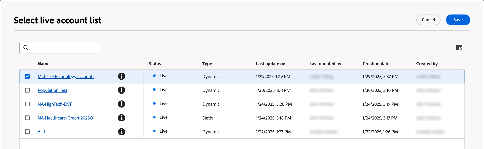
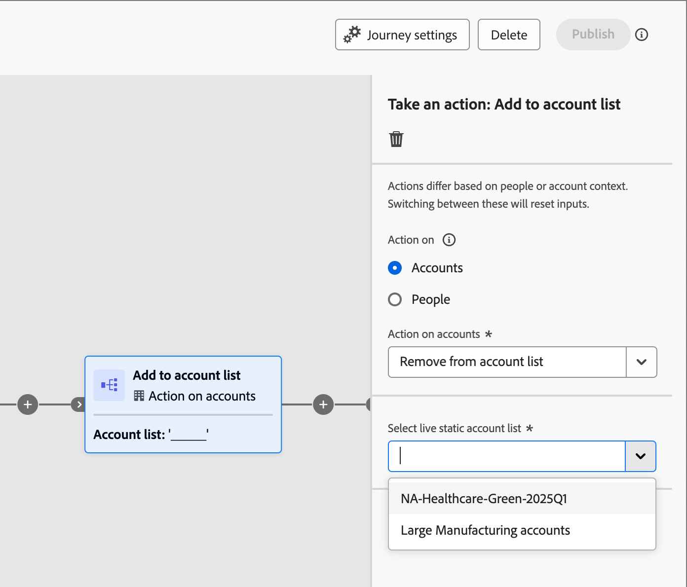

# ジャーニーでのアカウントリストの使用

ライブ（公開済み）アカウントリストをアカウントジャーニーに組み込む方法はいくつかあります。

## アカウントオーディエンスノード

すべてのアカウントジャーニーは、[_アカウントオーディエンス_ ノード ](../journeys/account-audience-nodes.md)から始まります。 このノードをアカウントリストを使用するように設定すると、メンバーアカウントは公開時にジャーニーを移動します。

1. 開始&#x200B;_アカウントオーディエンス_ ノードの&#x200B;**[!UICONTROL アカウントリスト]** オプションを選択します。

   {width="500"}

1. 「**[!UICONTROL アカウントリストを追加]**」をクリックします。

1. アカウントリストのチェックボックスを選択し、**[!UICONTROL 保存]**&#x200B;をクリックします。

   {width="600" zoomable="yes"}

## アクションノードを作成 – アカウントに追加

**_静的アカウントリストのみ_**

アカウントジャーニー内で、[a _アクションを実行_ ノード ](../journeys/action-nodes.md)を使用してアカウントを静的アカウントリストに追加します。

たとえば、電子メールを送信するジャーニーパスがあり、一部のアカウントが応答としてさまざまなアクションを実行するとします。 このアクティビティは、ジャーニーの選定ポイントとみなされます。 クオリフィケーションを使用すると、クオリファイドアカウントに対して異なるフローを持つ別のジャーニーのオーディエンスとして使用されるアカウントリストにこれらを追加します。

>[!NOTE]
>
>ノードの実行時にアカウントがリストに既に存在する場合、そのアクションは無視されます。

1. 「]_**[!UICONTROL アカウント]**」の「_[!UICONTROL  アクション」オプションを選択します。

1. _[!UICONTROL アカウントに対するアクション]_&#x200B;で、**[!UICONTROL アカウントリストに追加]**&#x200B;を選択します。

   {width="500"}

1. **[!UICONTROL ライブ静的アカウントリストを選択]**&#x200B;するには、アカウントを追加するアカウントリストを選択します。

   {width="500"}

## アクションノードを作成 – アカウントから削除

**_静的アカウントリストのみ_**

アカウントジャーニー内で、[a _アクションを実行_ ノード ](../journeys/action-nodes.md)を使用して、静的アカウントリストからアカウントを削除します。

たとえば、電子メールを送信するジャーニーパスがあり、一部のアカウントが応答としてさまざまなアクションを実行するとします。 このアクティビティは、ジャーニーの選定ポイントとみなされます。 この選定では、アカウントリストからこれらを削除します。 このリストは、資格に関するコミュニケーションが重複しないように、追加のメールを送信する別のジャーニーのオーディエンスとして使用されます。

>[!NOTE]
>
>削除がスケジュールされているリストにアカウントが含まれていない場合、アクションは無視されます。

1. 「]_**[!UICONTROL アカウント]**」の「_[!UICONTROL  アクション」オプションを選択します。

1. _[!UICONTROL アカウントに対するアクション]_&#x200B;で、**[!UICONTROL アカウントリストから削除]**&#x200B;を選択します。

   {width="500"}

1. **[!UICONTROL ライブ静的アカウントリストを選択]**&#x200B;するには、アカウントを削除するアカウントリストを選択します。

   {width="500"}

## パスの分割ノード – アカウントリストのアカウントメンバー {#split-paths-account-member-of-account-list}

**_アカウントジャーニーのみ_**

アカウント別に分割される&#x200B;[_パス_ ノード ](../journeys/split-merge-paths-nodes.md#add-a-split-path-by-account-node)の&#x200B;_[!UICONTROL アカウントリストのアカウントメンバー]_ フィルターを使用します。 アカウントは、選択した1つ以上のアカウントリストのメンバーであるか、またはメンバーではありません。 リストにアカウントを含めるには、メンバーシップを`true`に設定するか、アカウントを除外するために`false`に設定します。

アカウントを除外するには、_[!UICONTROL Account Member of Account List]_ フィルターを追加し、メンバーシップを`false`に設定して、リストを選択します。

1. ジャーニーマップに移動します。

1. パスのプラス（**+**）アイコンをクリックし、「**[!UICONTROL パスを分割]**」を選択します。

1. 右側のノードプロパティで、分割に「**[!UICONTROL アカウント]**」を選択します。

1. _[!UICONTROL パス 1]_&#x200B;の条件を定義するには、「**[!UICONTROL 条件を適用]**」をクリックします。

1. アカウントリストフィルターを定義します。

   * 条件エディターで、_[!UICONTROL 特殊フィルター]_ フォルダーを展開し、**[!UICONTROL アカウントリストのアカウントメンバー]** フィルターを条件ワークスペースにドラッグします。

   * リストにアカウントを含めるには、メンバーシップを`true`に設定するか、アカウントを除外するために`false`に設定します。

   * 1つ以上のアカウントリストを選択します。

   {width="700" zoomable="yes"}

   アカウントリストのメンバーシップフィルターを他のアカウントフィルターと組み合わせて、すべての条件または任意の条件に一致するように選択できます。 上部の&#x200B;**[!UICONTROL フィルターロジック]**&#x200B;を適用して、条件を絞り込みます。

1. 「**[!UICONTROL 完了]**」をクリックします。

「[ アカウントノードごとに分割パスを追加](../journeys/split-merge-paths-nodes.md#add-a-split-path-by-account-node)」の説明に従って、分割パスノードの設定を続行します。

## パスの分割ノード – アカウントリストの人物メンバー {#split-paths-member-of-account-list}

**_ユーザージャーニーのみ_**

ユーザージャーニーの&#x200B;[_分割パス_ ノード ](../journeys/split-merge-paths-nodes.md)のアカウントリストメンバーシップフィルターを使用して、アカウントがアカウントリストのメンバーであるかどうかに基づいてユーザーをルーティングします。 次の2つのフィルターを使用できます。

| フィルター | 説明 |
| ------ | ----------- |
| [!UICONTROL  アカウント動的リストの人物] | ユーザーのアカウントは、1つ以上の動的アカウントリストのメンバーであるか、またはメンバーではありません。 |
| [!UICONTROL  アカウント静的リストの人物メンバー] | ユーザーのアカウントが1つ以上の静的アカウントリストのメンバーであるか、メンバーでないか。 |

Nurture パスからブロックリストに加えるアカウントのユーザーを除外するには、_[!UICONTROL Person Member of Account Static List]_ フィルターを追加し、演算子を`is not`に設定してリストを選択します。

1. ジャーニーマップに移動します。

1. パスのプラス（**+**）アイコンをクリックし、「**[!UICONTROL パスを分割]**」を選択します。

1. _[!UICONTROL パス 1]_&#x200B;の条件を定義するには、「**[!UICONTROL 条件を適用]**」をクリックします。

1. アカウントリストフィルターの定義

   * 条件エディターで、_[!UICONTROL 特殊フィルター]_ フォルダーを展開し、**[!UICONTROL アカウント動的リストの人物]**&#x200B;または&#x200B;**[!UICONTROL アカウント静的リストの人物メンバー]** フィルターを条件ワークスペースにドラッグします。

   * アカウントがリストに含まれているユーザーを含めるには、演算子を`is`に設定するか、`is not`に設定して除外します。

   * 1つ以上のアカウントリストを選択します。

     {width="700" zoomable="yes"}

   アカウントリストメンバーシップフィルターを他の人物フィルターと組み合わせて、すべての条件または任意の条件に一致するように選択できます。 上部の&#x200B;**[!UICONTROL フィルターロジック]**&#x200B;を適用して、条件を絞り込みます。

1. 「**[!UICONTROL 完了]**」をクリックします。

[人物ノードによる分割パスの追加](../journeys/split-merge-paths-nodes.md#add-a-split-path-by-people-node)の説明に従って、分割パスノードの設定を続行します。
