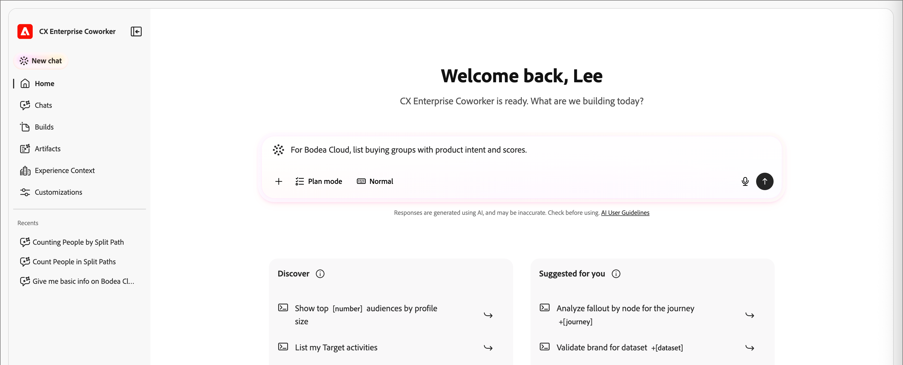

# B2B アカウントと人物向けのオーディエンススキル

[!DNL CX Coworker] インターフェイスでB2Bのオーディエンススキルを使用します。 アカウントや人物をまたいで製品の意図を調査できます。 関連するペルソナを特定し、購買グループのカバー範囲を評価し、購買グループの役割テンプレートを作成します。

* 特定の製品に対するアカウントの関心を評価し、インテントの傾向を比較します。
* 製品への関心に関連する人物とペルソナを特定。
* 購買グループの役割をレビューして、カバーされていない部分を特定。
* 購買グループの役割テンプレートを生成して調整：

>[!PREREQUISITES]
>
>B2B アカウントと人物にオーディエンススキルを使用する前に、次のデータ定義とマッピングを設定します。
>
>* [&#x200B; インテント データの分類とマッピング &#x200B;](../admin/intent-data.md)
>* [XDM フィールドマッピング &#x200B;](#xdm-data-prerequisites)

アプリケーションの上部にある「_[!DNL Coworker]_&#x200B;に質問（![[!DNL Coworker]](../assets/do-not-localize/icon-ask-coworker.svg)に質問）」アイコンをクリックして、[!DNL Coworker] アプリケーションを開きます。 チャットインターフェイスに自然言語プロンプトを入力します。

[!DNL CX Coworker]{width="800" zoomable="yes"}の オーディエンスプロンプト

## オーディエンススキルの注目分野

オーディエンスのスキルを活用して、アカウントの意図を探り、人物やペルソナを把握し、購買グループテンプレートを準備します。

| Focus | タスク |
| ----- | ----- |
| アカウントインテント | 低、中、高のインテントレベルを使用して、特定の製品に対するアカウントのインテントを評価します。 製品の興味関心のトレンドを時系列で比較し、特定の製品に関心を示しているアカウントを特定します。 エンゲージメントパターンとペルソナのカバー範囲を確認します。 |
| 人物とペルソナ | 1つ以上の製品をまたいで、製品の意図ごとにペルソナを特定し、ランク付けできます。 成約率、メンバーシップ率、カウントなど、商談の指標を確認できます。 _Champion_、_意思決定者_、_インフルエンサー_&#x200B;などの役割にペルソナをマッピングし、役割の割り当てに関する説明を確認します。 |
| 購買グループのカバー範囲 | 購買グループのサイズとペルソナのカバー範囲をアカウントをまたいで評価します。 役割の分布を確認し、欠けているペルソナや役割を特定する。 最近のバーゲンセールで特定された優勝者を含むアカウントを検索できます。 |
| 購買グループテンプレート | 特定の製品の購買グループのロールテンプレートを生成し、推奨されるペルソナのマッピングを確認します。 ペルソナや役割を含めたり除外したりして、テンプレートを絞り込むことができます。 購買グループを作成する前に、必要な役割を検証します。 |

## 制限事項

オーディエンスのインサイトは、設定されたインテント分類法、XDM フィールドマッピング、エクスペリエンスイベントデータによって異なります。 不完全なオポチュニティデータ、分類基準の欠如や古い分類、プロファイル識別子やアカウント識別子の欠落などは、insightの信頼性を低下させる可能性があります。

インテント計算では、次のエクスペリエンスイベントのみを使用します：`directMarketing.emailClicked`、`directMarketing.emailOpened`、`directMarketing.emailUnsubscribed`、および`web.webpagedetails.pageViews`。

## プロンプトの例

[!DNL CX Coworker] インターフェイスに次のプロンプトを入力して、アカウントの意図を調べ、人物とペルソナを理解し、購買グループテンプレートを準備します。

### アカウントインテント

製品に対するアカウントの関心を調査し、意図の変化を確認します。

* トレンドウィンドウを表示：製品ごとのアカウント製品インテントの最新および最新の更新。
* どのアカウントでも商品の購買意欲は低いものの、まだ商談を開いている（ナーチャリングする価値がある）のでしょうか？
* 今週`<account_name>`に対して記録された新しい意図シグナルは何ですか？

### 人物とペルソナ

製品への関心に関連するペルソナを特定し、推奨される購買グループの役割を確認できます。

* `<product>`に関連するペルソナを表示します。
* `<product>`のペルソナマッピングの推奨事項への役割を表示します。
* `<product>`の場合、ペルソナと役割を商談指標（成約率、メンバーシップ率、カウント）でリストアップします。

### 購買グループとテンプレート

購買グループの意図とカバー範囲を確認し、テンプレートを生成または調整できます。

* `<product>`の場合、製品の意図とスコアを使用して購買グループをリスト化します。
* `<industry>`のアカウントの場合、`<product>`の平均アカウントペルソナのカバー範囲は何ですか？
* `<product>`の購買グループテンプレートを作成します。
* `<persona>` ペルソナを使用せずに`<product>`の購買グループテンプレートを作成し、`<role>`の役割を削除します。

## 概念

これらの概念は、アカウントの意図、ペルソナのランキング、購買グループのレコメンデーションなどを解釈するために使用できます。

| 概念 | 説明 |
| ------- | ----------- |
| オーディエンス検出 | アカウント内の複数の人物をまたいでファーストパーティのエンゲージメントシグナルを分析し、製品への関心と関連するペルソナを特定します。 分析では、商談がクローズする前のアクティビティを含め、過去18 ヶ月のアクティビティを考慮します。 エンゲージメントパターンは、オポチュニティデータが不完全な場合に製品の意図を示すことができますが、データが欠落している場合はinsightの信頼性が低下する可能性があります。 |
| ペルソナ | ペルソナは、正規化された役職、機能、年功ごとに人物をグループ化します。 ペルソナを使用して、意思決定者、インフルエンサー、サポート担当者など、アカウント内で誰がエンゲージしているのかを把握できます。 |
| 購買グループの役割のマッピング | 役職、機能、年功、設定された属性にもとづいて、ペルソナを製品固有の購買グループの役割にマッピングできます。 これらの役割は、購入に影響を与えたり、購入を決定したりするアカウント内の人物を表します。 カバーしている部分を確認して、欠けている役割を特定します。 |
| ペルソナランキング用の機会データ | 商談ステージ、成約日、機会と製品のマッピングにより、各製品のペルソナのランキングをサポートしています。 商談データが不完全な場合、ランキングでは、アクティビティの量と時間減衰を使用して、最近のアクティビティの重みを増やします。  製品リンクは、使用可能な場合、提供または生成された商談と製品のマッピングテーブルを使用します。 そうでなければ、あいまいなマッチングの機会が商品にリンクされます。 リンクが利用できない場合、商談の成約日より前の最近のアクティビティから製品インテントが推測されます。 これらのフォールバック方法は、不完全なデータの信頼性の制限を排除するものではありません。 |
| 機会分析 | 過去の商談分析では、3つの側面を用いて、購買結果に関連するペルソナパターンを特定します。<ul><li>成約率：特定のペルソナが関与した場合に、商談が獲得される頻度を測定します。 成約率の高いペルソナパターンは、より多くの重みを付与します。</li><li>メンバーシップ率：特定の製品の商談にペルソナが表示される頻度を測定します。</li><li>ペルソナの影響：ペルソナが存在するかどうかだけでなく、ペルソナのエンゲージメントやアクティビティが成約とどのように相関関係にあるかを測定します。</li></ul>これらのシグナルは、アカウントの意図、ペルソナマッピング、購買グループのレコメンデーションに反映されます。 |
| 目的 | インテント：web ページへの訪問やメールリンクのクリックなど、エンゲージメントを通じた製品への関心を示します。 製品分類は、エンゲージメント活動をキーワード、製品、製品カテゴリに結びつけます。 エンゲージメントの深さと頻度は、キーワード、製品、製品カテゴリごとに個々のインテントスコアを決定します。   スコアは関心の強さを示します：低いインテント：`<=0.2`、Mediumのインテント：`0.2 < score <= 0.6`、高いインテント：`0.6 < score <= 1`。  個々のインテント スコアは、アカウントのインテントを判断するために、同じアカウントの人物をまたいで集計されます。 |
| 購買グループに影響を与える役割 | 購買グループの役割は、購入の決定に対するさまざまな貢献を表します。 _意思決定者_&#x200B;は、通常、予算の承認を管理します。 _インフルエンサー_&#x200B;のシェイプの評価とレコメンデーション。 _チャンピオン_&#x200B;が社内の合意を形成します。 _エンドユーザー_&#x200B;が製品の適合性を検証します。  役割の割り当てとカバー範囲を確認して、決定に影響を与えるユーザーとエンゲージメントのギャップが残っているユーザーを把握します。 |
| ペルソナや役割のカバー | カバー率は、アカウント内に少なくとも1人の代表者がいる、予測されるペルソナまたは役割の数を測定します。 _N_&#x200B;個のペルソナまたは役割が想定されている製品の場合、完全なカバレッジとは、_N_&#x200B;個すべてが表されることを意味します。 部分的なカバレッジは、一部が欠落していることを意味します。 カバー率を使用して購買グループの完全性を評価し、ギャップを特定します。 |

## XDM データの前提条件

アカウントのインテント分析、ペルソナ識別、購買グループの役割マッピングをサポートするために、次のXDM フィールドマッピングを設定します。

### XDM フィールドマッピング

<table>
  <tbody>
    <tr>
      <th>XDM フィールド</th>
      <th>エンティティ</th>
      <th>ビジネス定義</th>
      <th>追加詳細</th>
    </tr>
    <tr>
      <td>
        

          b2b.accountKey.sourceKey
        

      </td>
      <td>
        

          プロファイル
        

      </td>
      <td>アカウント識別子。商談、イベント、インテントデータの結合に使用されます</td>
      <td rowspan="2">商談分析  アカウント探索 
         
      </td>
    </tr>
    <tr>
      <td>
        

          b2b.personKey.sourceKey
        

      </td>
      <td>
        

          プロファイル
        

      </td>
      <td>人物ID。イベントデータからプロファイルデータへの結合に使用されます</td>
    </tr>
    <tr>
      <td>
        

          extendedWorkDetails.departments
        

      </td>
      <td>
        

           プロファイル 
        

      </td>
      <td>プロファイル/人物の担当部署</td>
      <td rowspan="5">
        

           
        

        
ペルソナマッピング

      </td>
    </tr>
    <tr class="">
      <td>
        

          extendedWorkDetails.jobTitle
        

      </td>
      <td>
        

           プロファイル 
        

      </td>
      <td>ペルソナ計算で使用されるプロファイル/人物の役職</td>
    </tr>
    <tr>
      <td>
        

          person.name.firstName
        

      </td>
      <td>
        

          プロファイル
        

      </td>
      <td>クエリに一致する結果にユーザーの名前を表示します。</td>
    </tr>
    <tr class="">
      <td>
        

          person.name.fullName
        

      </td>
      <td>
        

           プロファイル 
        

      </td>
      <td>クエリに一致する結果にユーザーのフルネームを表示します。</td>
    </tr>
    <tr class="">
      <td>
        

          person.name.lastName
        

      </td>
      <td>
        

           プロファイル 
        

      </td>
      <td>ユーザーの姓をクエリに一致する結果で表示します。</td>
    </tr>
    <tr>
      <td>
        

          accountKey.sourceKey
        

      </td>
      <td>
        

           アカウント 
        

      </td>
      <td>アカウント識別子。商談、イベント、インテントデータの結合に使用されます</td>
      <td>商談分析  アカウント探索</td>
    </tr>
    <tr>
      <td>
        

          accountName
        

      </td>
      <td>
        

          アカウント
        

      </td>
      <td>クエリに一致する結果にアカウント名を表示します。</td>
      <td rowspan="4">
        

           
        

        

           
        

        

           
        

        
アカウント探索

      </td>
    </tr>
    <tr>
      <td>
        

          accountDescription
        

      </td>
      <td>
        

          アカウント
        

      </td>
      <td>クエリに基づいてアカウントの説明でアカウントのフィルタリングをサポートします。</td>
    </tr>
    <tr>
      <td>
        

          accountOrganization.industry
        

      </td>
      <td>
        

           アカウント 
        

      </td>
      <td>クエリに基づいて業界ごとのアカウントのフィルタリングをサポートします。</td>
    </tr>
    <tr>
      <td>
        

          accountBillingAddress.region
        

      </td>
      <td>
        

           アカウント 
        

      </td>
      <td>クエリに基づく請求先住所の地域によるアカウントのフィルタリングをサポートします。</td>
    </tr>
    <tr>
      <td>
        

          accountKey.sourceKey
        

      </td>
      <td>
        

          商談
        

      </td>
      <td>アカウント識別子。商談、イベント、インテントデータの結合に使用されます</td>
      <td rowspan="2">
        
商談分析  アカウント探索

      </td>
    </tr>
    <tr>
      <td>
        

          opportunityKey.sourceKey
        

      </td>
      <td>
        

          商談
        

      </td>
      <td>商談識別子。アカウント データの結合に使用されます</td>
    </tr>
    <tr>
      <td>
        

          opportunityName
        

      </td>
      <td>
        

          件の商談
        

      </td>
      <td>商談分析で使用される商談名。</td>
      <td rowspan="5">
        

           
        

        

           
        

        

           
        

        

           
        

        

           
        

        
商談分析

      </td>
    </tr>
    <tr>
      <td>
        

          isWon
        

      </td>
      <td>
        

          商談
        

      </td>
      <td>商談が獲得されたかどうか（バイナリ）</td>
    </tr>
    <tr>
      <td>
        

          opportunityDescription
        

      </td>
      <td>
        

          商談
        

      </td>
      <td>商談分析で使用される商談の説明。</td>
    </tr>
    <tr>
      <td>
        

          opportunityAmount
        

      </td>
      <td>
        

          商談
        

      </td>
      <td>商談に関係する$の金額</td>
    </tr>
    <tr class="">
      <td>
        

          opportunityType
        

      </td>
      <td>
        

          商談
        

      </td>
      <td>機会の種類</td>
    </tr>
    <tr>
      <td>
        

          opportunityStage
        

      </td>
      <td>
        

          件の商談
        

      </td>
      <td>商談のステージ（成約または成約の失注、または中間ステージ） </td>
      <td rowspan="4">
        
商談分析  アカウント探索

      </td>
    </tr>
    <tr>
      <td>
        

          actualCloseDate
        

      </td>
      <td>
        

          商談
        

      </td>
      <td>商談の実際のクローズ日</td>
    </tr>
    <tr>
      <td>
        

          expectedCloseDate
        

      </td>
      <td>
        

          件の商談
        

      </td>
      <td>商談の予定クローズ日</td>
    </tr>
    <tr>
      <td>
        

          extSourceSystemAudit.createdDate
        

      </td>
      <td>
        

          商談
        

      </td>
      <td>この商談の作成日</td>
    </tr>
  </tbody>
</table>

### 分類データ

オーディエンススキルは、[!DNL Adobe Journey Optimizer B2B Edition]からのファーストパーティのインテントデータを使用します。 インテント計算は、製品分類とエンゲージメント活動を結びつけ、アカウントレベルでの個々のスコアを集計します。

1. インテント計算には、顧客/分類から分類データ（顧客製品および対応するキーワード）が必要です
1. 分類データは、イベントデータのラベル付けに使用されます（アセットのラベル付け）。 このデータは、イベントデータ/アセットのラベル付けにもとづいて、訪問者が関心を持つキーワードや製品に関するインサイトを提供します 
1. ラベル付きアセット（イベントデータ）を訪問者行動（訪問したページ数）と組み合わせて、キーワード、製品、製品カテゴリーレベル、インテント計算で訪問者の意図→判断します
1. 訪問者プロファイルレベルのインテントスコアは、アカウントレベルで集計され、特定のキーワード、製品および製品カテゴリにおけるアカウントの意図を判断します> インテントアカウント集計

インテント分類法[&#128279;](../admin/intent-data.md)の設定に加えて、次のフィールドが必要です。

<table>
  <tbody>
    <tr>
      <th>XDM フィールド</th>
      <th>エンティティ</th>
      <th>ビジネス定義</th>
    </tr>
    <tr>
      <th>
         
      </th>
      <th>
         
      </th>
      <td>顧客プロファイル</td>
    </tr>
    <tr>
      <td>
        

          _acp_system_metadata.primaryIdentity.namespace.code 
          
        

      </td>
      <td>
        

          プロファイル
        

      </td>
      <td>個人（メールまたはb2b_person） IDの識別に役立ちます</td>
    </tr>
    <tr>
      <td>
        

          _acp_system_metadata.primaryIdentity.id
          
        

      </td>
      <td>
        

          プロファイル
        

      </td>
      <td>namespace_id</td>
    </tr>
    <tr>
      <td>
        <ul>
          <li>keyword_id</li>
          <li>keyword_name</li>
          <li>product_id</li>
          <li>product_name</li>
          <li>product_category_id</li>
          <li>product_category_name</li>
        </ul>
      </td>
      <td>
        

           
        

      </td>
      <td>アセット（クリックされた電子メール、訪問したweb ページなどのエクスペリエンスイベント）にラベルを付けるための分類法として使用</td>
    </tr>
    <tr>
      <td>
        

           タイムスタンプ 
        

      </td>
      <td>
        

           エクスペリエンスイベント 
        

      </td>
      <td>バックフィルと増分実行を取得する時間に使用します</td>
    </tr>
    <tr>
      <td>
        

          eventType
        

      </td>
      <td>
        

           エクスペリエンスイベント 
        

      </td>
      <td>イベントタイプを識別します。 インテント計算では、<code>directMarketing.emailClicked</code>、<code>directMarketing.emailOpened</code>、<code>directMarketing.emailUnsubscribed</code>、<code>web.webpagedetails.pageViews</code>のみを使用します。
      </td>
    </tr>
    <tr>
      <td>
        

          directMarketing.mailingName
        

      </td>
      <td>
        

           エクスペリエンスイベント 
        

      </td>
      <td>参照/簿記のみ。キャンペーン名に関する情報</td>
    </tr>
    <tr>
      <td>
        

          directMarketing.mailingKey.sourceID
        

      </td>
      <td>
        

           エクスペリエンスイベント 
        

      </td>
      <td>参照/ブックマークの場合のみ。電子メールのターゲットとなるソース IDに関する情報</td>
    </tr>
    <tr>
      <td>
        

          directMarketing.mailingKey.sourceInstanceID 
          
        

      </td>
      <td>
        

           エクスペリエンスイベント 
        

      </td>
      <td>参照/ブックマークの場合のみ。電子メールのターゲットとなるソースインスタンスの情報</td>
    </tr>
    <tr>
      <td>
        

          directMarketing.mailingKey.sourceKey 
          
        

      </td>
      <td>
        

           エクスペリエンスイベント 
        

      </td>
      <td>[!DNL Adobe Marketo Engage] データセンターからメール コンテンツを取得するために使用します。 （SourceID@SourceInstanceID.SourceType）を含みます。</td>
    </tr>
    <tr>
      <td>
        

          directMarketing.mailingKey.sourceType 
          
        

      </td>
      <td>
        

           エクスペリエンスイベント 
        

      </td>
      <td>参照/簿記のためのみ。ソースのタイプまたはソースの出所に関する情報 </td>
    </tr>
    <tr>
      <td>
        

          web.webPageDetails 
          
        

      </td>
      <td>
        

           エクスペリエンスイベント 
        

      </td>
      <td>Web ページ訪問ソースのオリジンに関する情報</td>
    </tr>
    <tr>
      <td>
        

          web.webPageDetails.name 
          
        

      </td>
      <td>
        

           エクスペリエンスイベント 
        

      </td>
      <td>コンテンツの取得に使用される実際のURL</td>
    </tr>
    <tr>
      <td>
        

          web.webPageDetails.queryParameters
        

      </td>
      <td>
        

           エクスペリエンスイベント 
        

      </td>
      <td>ターゲットコンテンツの取得に使用するURLの追加クエリパラメーター </td>
    </tr>
    <tr>
      <td>
        

          web.webPageDetails.isPersonalizedURL
        

      </td>
      <td>
        

           エクスペリエンスイベント 
        

      </td>
      <td>参照/簿記のみ</td>
    </tr>
    <tr>
      <td>
        

          web.webPageDetails.webPageKey.sourceID 
          
        

      </td>
      <td>
        

           エクスペリエンスイベント 
        

      </td>
      <td>参照/ブックマークの場合のみ。電子メールのターゲットとなるソース IDに関する情報</td>
    </tr>
    <tr>
      <td>
        

          web.webPageDetails.webPageKey.sourceInstanceID 
          
        

      </td>
      <td>
        

           エクスペリエンスイベント 
        

      </td>
      <td>参照/ブックマークの場合のみ。電子メールの対象となったソースインスタンスに関する情報</td>
    </tr>
    <tr class="">
      <td>
        

          web.webPageDetails.webPageKey.sourceKey 
          
        

      </td>
      <td>
         エクスペリエンスイベント 
      </td>
      <td>参照/簿記のみを目的とし、（SourceID@SourceInstanceID.SourceType）で構成されます。</td>
    </tr>
    <tr>
      <td>
        

          web.webPageDetails.webPageKey.sourceType
        

      </td>
      <td>
         エクスペリエンスイベント 
      </td>
      <td>参照/簿記のみ。ソースのタイプまたはソースの出所に関する情報</td>
    </tr>
    <tr>
      <td>
        

          web.webPageDetails.webPageKey.URL
        

      </td>
      <td>
         エクスペリエンスイベント 
      </td>
      <td>web.webPageDetails.nameにURLがない場合に、実際のURLを取得するために使用します。</td>
    </tr>
  </tbody>
</table>
