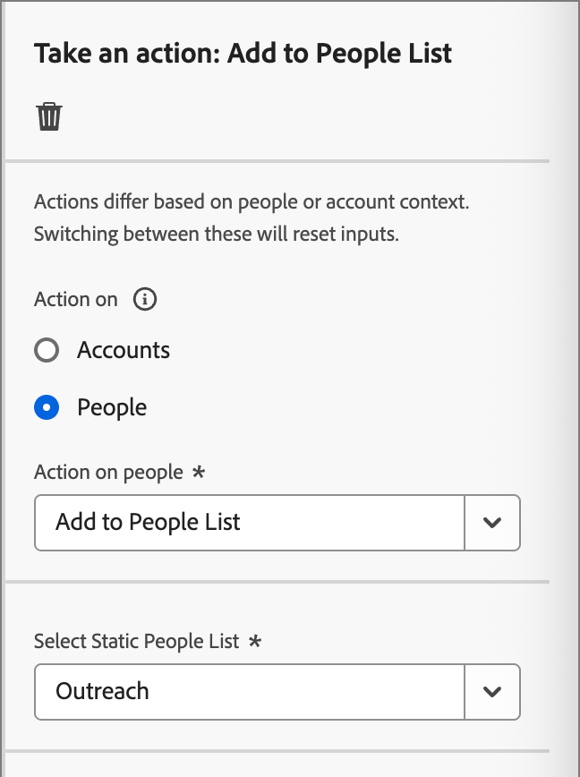

# ジャーニーでの人物リストの使用

アカウントのジャーニーおよび個人のジャーニーに[人のリスト &#x200B;](./people-lists.md)を組み込む方法は、複数あります。

* **ジャーニーからの静的リストの管理** - _アクションを実行_ ノードで、_[!UICONTROL 人物リストに追加]_&#x200B;または&#x200B;_[!UICONTROL 人物リストから削除]_ アクションを使用して、人物がジャーニーを移動する際に静的な人物リストのメンバーシップを更新します。
* **リスト メンバーシップに基づいてユーザーをルーティング** - _分割パス_ ノードで、_[!UICONTROL ユーザーの静的リストのメンバー]_&#x200B;または&#x200B;_[!UICONTROL ユーザーの動的リストのメンバー]_ フィルターを使用して、リストのメンバーである（またはそうでない）ユーザーのパスを作成します。

例えば、チームメンバーとパートナーの除外リストを作成し、そのリストをもとにナーチャリングパスから除外できます。 または、あるジャーニーの選定ポイントに達したユーザーを静的リストに追加し、そのリストを使用して別のジャーニーのユーザーを分岐させることもできます。

## アクションノードを作成 – 人物リストに追加 {#add-to-people-list}

**_静的な人物リストのみ_**

アカウントまたは個人のジャーニー内で、[a _アクションを実行_ ノード &#x200B;](../journeys/action-nodes.md#people-actions)を使用して、静的な人物リストに人物を追加します。

たとえば、電子メールを送信するジャーニーパスを考えてみましょう。ウェビナーに登録する人もいます。 この応答は、ジャーニーの選定ポイントとみなされます。 クオリフィケーション時に、これらの人物を別のジャーニーが使用する静的な人物リストに追加し、クオリファイドリードを別のパスに分割します。

>[!NOTE]
>
>ノードの実行時にユーザーが既にリストに登録されている場合、そのアクションは無視されます。

1. ジャーニーマップに移動します。

1. パスのプラス（**+**）アイコンをクリックし、**[!UICONTROL アクションを実行]**&#x200B;を選択します。

1. （アカウントジャーニーのみ）「_&#x200B;**[!UICONTROL 人物]**」オプションで「_ アクション」を選択します。

1. _[!UICONTROL 人物に対するアクション]_&#x200B;で、**[!UICONTROL 人物リストに追加]**&#x200B;を選択します。

1. **[!UICONTROL 静的な人物リストを選択]**&#x200B;するには、人物を追加する人物リストを選択します。

   {width="300"}

## アクションノードを作成 – 人物リストから削除 {#remove-from-people-list}

**_静的な人物リストのみ_**

アカウントまたは個人のジャーニー内で、[a _アクションを実行_ ノード &#x200B;](../journeys/action-nodes.md#people-actions)を使用して、静的な人物リストから人物を削除します。

例えば、オーディエンスがコンバージョンした後、静的リストからそのオーディエンスを削除します。 このリストは、ナーチャリングコミュニケーションを受け取らないように、ユーザーをナーチャリングパスに誘導するために使用されます。

>[!NOTE]
>
>削除がスケジュールされているリストにユーザーが含まれていない場合、そのアクションは無視されます。

1. ジャーニーマップに移動します。

1. パスのプラス（**+**）アイコンをクリックし、**[!UICONTROL アクションを実行]**&#x200B;を選択します。

1. （アカウントジャーニーのみ）「_&#x200B;**[!UICONTROL 人物]**」オプションで「_ アクション」を選択します。

1. _[!UICONTROL 人物に対するアクション]_&#x200B;で、**[!UICONTROL 人物リストから削除]**&#x200B;を選択します。

1. **[!UICONTROL 静的な人物リストを選択]**&#x200B;するには、人物を削除する人物リストを選択します。

   {width="300"}

## パスの分割ノード – 人物リストのメンバー {#split-paths-by-list-membership}

**_アカウントとユーザーのジャーニー_**

[_分割パス_ ノード &#x200B;](../journeys/split-merge-paths-nodes.md)の人物リストメンバーシップフィルターを使用して、人物リストのメンバーであるかどうかに基づいて人物をルーティングします。 次の2つのフィルターを使用できます。

| フィルター | 説明 |
| ------ | ----------- |
| [!UICONTROL People Dynamic Listの人物メンバー] | ユーザーは、1つ以上の動的な人物リストのメンバーであるか、またはメンバーではありません。 メンバーシップは、リストの現在のルールを反映します。 |
| [!UICONTROL 人物の静的リスト &#x200B;]のメンバー | ユーザーは、1つ以上の静的な人物リストのメンバーであるか、メンバーではありません。 |

これらのフィルターは、両方のジャーニータイプで使用できます。

* **人物ジャーニー** - _分割パス_ ノード内。
* **アカウントジャーニー** - _パスを分割_ ノードで、_[!UICONTROL 人]_&#x200B;ごとに分割します。

ナーチャリングパスからチームメンバーとパートナーを除外するには、_[!UICONTROL 人物のメンバー静的リスト]_ フィルターを追加し、演算子を`is not`に設定してリストを選択します。

1. ジャーニーマップに移動します。

1. パスのプラス（**+**）アイコンをクリックし、「**[!UICONTROL パスを分割]**」を選択します。

   {width="300" zoomable="no"}

1. （アカウントジャーニーのみ）人物の条件のノードを設定します。

   * 右側のノードプロパティで、分割に&#x200B;**[!UICONTROL 人物]**&#x200B;を選択します。

   * 条件に使用される&#x200B;**[!UICONTROL 属性]**&#x200B;を&#x200B;**[!UICONTROL 人属性のみ]**&#x200B;に設定します。

   {width="300" zoomable="no"}

1. _[!UICONTROL パス 1]_&#x200B;の条件を定義するには、「**[!UICONTROL 条件を適用]**」をクリックします。

1. 条件エディターで、_[!UICONTROL 特殊フィルター]_ フォルダーを展開し、**[!UICONTROL 人物メンバーの人物の動的リスト]**&#x200B;または&#x200B;**[!UICONTROL 人物メンバーの人物の静的リスト]** フィルターを条件ワークスペースにドラッグします。

   {width="700" zoomable="yes"}

1. リスト メンバーを含めるには、メンバーシップを`is`に設定します。

   除外するには、`is not`に設定します。

1. 評価する人物リストを選択します。

   フィールドにテキストを入力して、使用可能なリストをフィルタリングします。 ユーザーが作成した人物リストのみが選択できます。

1. 上部の&#x200B;**[!UICONTROL フィルターロジック]**&#x200B;を適用して、条件を絞り込みます。

   リストメンバーシップフィルターを他の人物フィルターと組み合わせて、すべての条件または任意の条件に一致するように選択できます。

1. 「**[!UICONTROL 完了]**」をクリックします。

[_人物による分割パスの追加_](../journeys/split-merge-paths-nodes.md#add-a-split-path-by-people-node)&#x200B;の説明に従って、分割パスノードの設定を続行します。 メンバーシップフィルターについて詳しくは、[_メンバーシップフィルター_](../journeys/split-merge-paths-nodes.md#membership-filtering)&#x200B;を参照してください。
