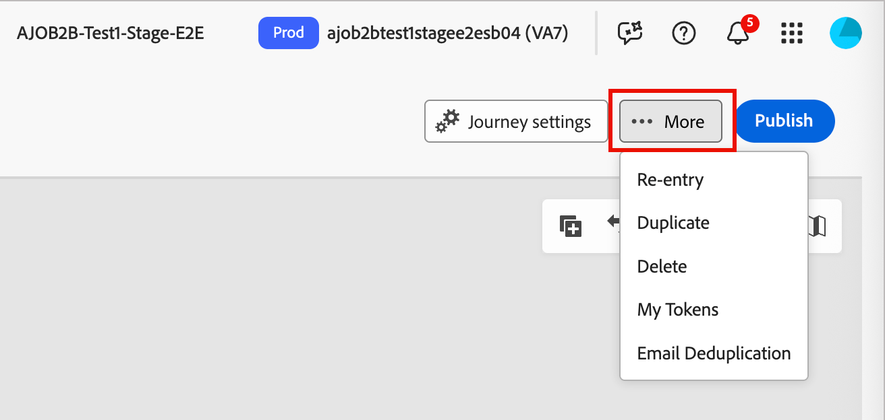
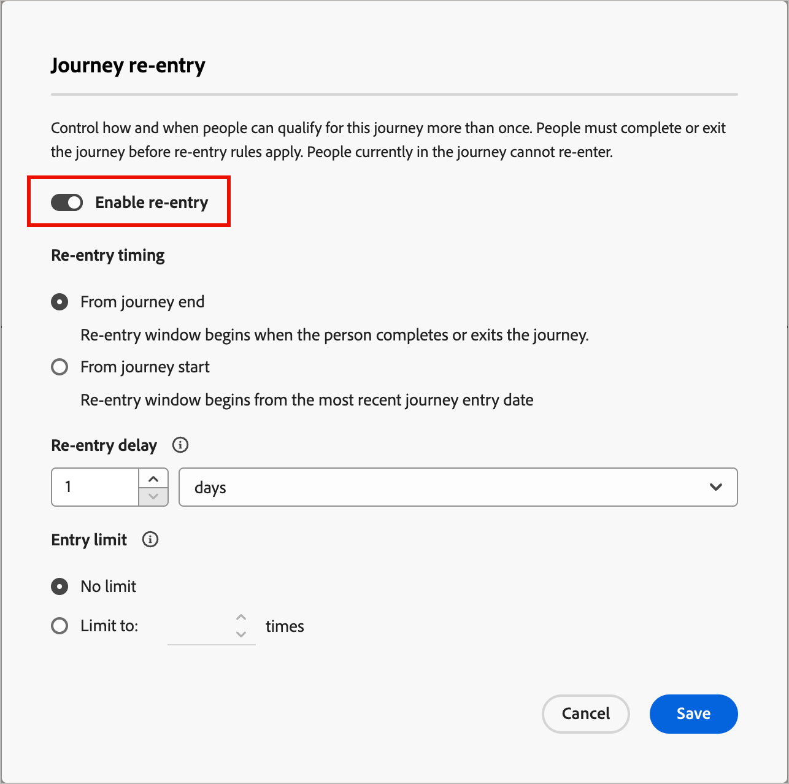

# ジャーニーの再入場

ジャーニーの再入力を有効にすると、アカウントまたはユーザーが同じジャーニーを再入力できるタイミングと頻度を制御できます。 再エントリ設定を使用して基準、制限、待機時間を設定し、アカウントまたはユーザーが管理された方法でジャーニーの再評価を行えるようにします。

アカウントまたは個人は、次の項目が該当する場合にジャーニーの再評価を行うことができます。

* アカウントまたは個人は、ジャーニーで許可されている再入力の数以内です。
* アカウントまたは個人が待機時間のしきい値（再評価する前に待機する最小時間）を満たしています。
* アカウントまたは人物は現在ジャーニーにありません。

## ジャーニーの再入力を有効にする

ジャーニーが&#x200B;_ドラフト_ ステータスの場合、再入力を有効にし、再入力設定を変更できます。

>[!BEGINTABS]

>[!TAB  アカウントジャーニー]

1. ドラフトアカウントジャーニーを開きます。

1. 右上の&#x200B;**[!UICONTROL その他…]** メニューをクリックし、**[!UICONTROL 再エントリ]**&#x200B;を選択します。

   {width="450"}

1. _[!UICONTROL ジャーニーの再エントリ]_ ダイアログで、**[!UICONTROL 再エントリを有効にする]** オプションを切り替えます。

   この機能を有効にすると、タイミング、遅延、制限のオプションが表示されます。

   有効な機能を持つアカウントジャーニーの{width="450"}

1. **[!UICONTROL 再エントリのタイミング]**&#x200B;で、待機の計算方法を選択します。

   * **[!UICONTROL ジャーニーの終了から待機]** – 待機期間は、アカウントがジャーニーを終了または完了したときに開始されます。 例えば、「アカウントがジャーニーを完了してから30日後に再エントリできます。」

   * **[!UICONTROL ジャーニーの開始から待機]** – 待機期間は、アカウントがジャーニーに最初にエントリした日時に基づきます。 例えば、「アカウントがジャーニーを開始してから30日後に再エントリできます。」

1. 時間または日数の待機期間である&#x200B;**[!UICONTROL 再エントリ遅延]**&#x200B;を設定します。

   この設定は、アカウントがジャーニーを終了または開始してから再入力できるまでの待機時間を決定します。

1. アカウントがジャーニーに参加できる最大時間を定義するには、**[!UICONTROL エントリ制限]**&#x200B;を設定します。

   アカウントが制限に達すると、制限がリセットされるか、ジャーニーが新しい制限で再公開されるまで、エントリの資格がなくなります。

   この制限は、そのジャーニーのアカウントごとに適用されます。

1. 「**[!UICONTROL 保存]**」をクリックします。

>[!TAB  ユーザージャーニー]

1. 人物ジャーニーのドラフトを開きます。

1. 右上の&#x200B;**[!UICONTROL その他…]** メニューをクリックし、**[!UICONTROL 再入力設定]**&#x200B;を選択します。

   {width="450"}

1. _[!UICONTROL ジャーニーの再エントリ]_ ダイアログで、**[!UICONTROL 再エントリを有効にする]** オプションを切り替えます。

   この機能を有効にすると、タイミング、遅延、制限のオプションが表示されます。

   有効な機能を持つユーザーのジャーニーの{width="450"}

1. **[!UICONTROL 再エントリのタイミング]**&#x200B;で、待機の計算方法を選択します。

   * **[!UICONTROL ジャーニーの終了から待機]** – 待機期間は、ユーザーがジャーニーを終了または完了したときに開始されます。 例えば、「ユーザーがジャーニーを完了してから30日後に再エントリできます。」

   * **[!UICONTROL ジャーニーの開始から待機]** – 待機期間は、ユーザーがジャーニーに最初にエントリした日時に基づきます。 例えば、「ユーザーがジャーニーを開始してから30日後に再エントリできます。」

1. 時間または日数の待機期間である&#x200B;**[!UICONTROL 再エントリ遅延]**&#x200B;を設定します。

   この設定は、ユーザーがジャーニーを終了または開始してから再入力できるまでの待機時間を決定します。

1. ユーザーがジャーニーに参加できる最大時間を定義するには、**[!UICONTROL エントリ制限]**&#x200B;を設定します。

   ユーザーが制限に達すると、制限がリセットされるか、ジャーニーが新しい制限で再公開されるまで、エントリの資格がなくなります。

   この制限は、ジャーニーごとに適用されます。

1. 「**[!UICONTROL 保存]**」をクリックします。

>[!ENDTABS]

## 進行と活動

公開されたアカウントまたは個人のジャーニーの場合、ジャーニーキャンバスにはジャーニーノードの[進行状況](./journeys-overview.md#review-account-progression)が表示されます。 各ノードには、そのノードに到達するアカウントまたは人物の数と、ライブジャーニーの場合はそのノードで現在の数が表示されます。 アカウントまたはユーザーがジャーニーに再入力するたびに、別々のエントリとしてカウントされます。

<!-- 
You can see how many times accounts have entered the journey. ?? 

When you drill in to [account details](../accounts/account-details.md), the account activity shows each time the account entered the journey. It includes explicit activity and a recurrence count so that you can see re-entries clearly.
-->
