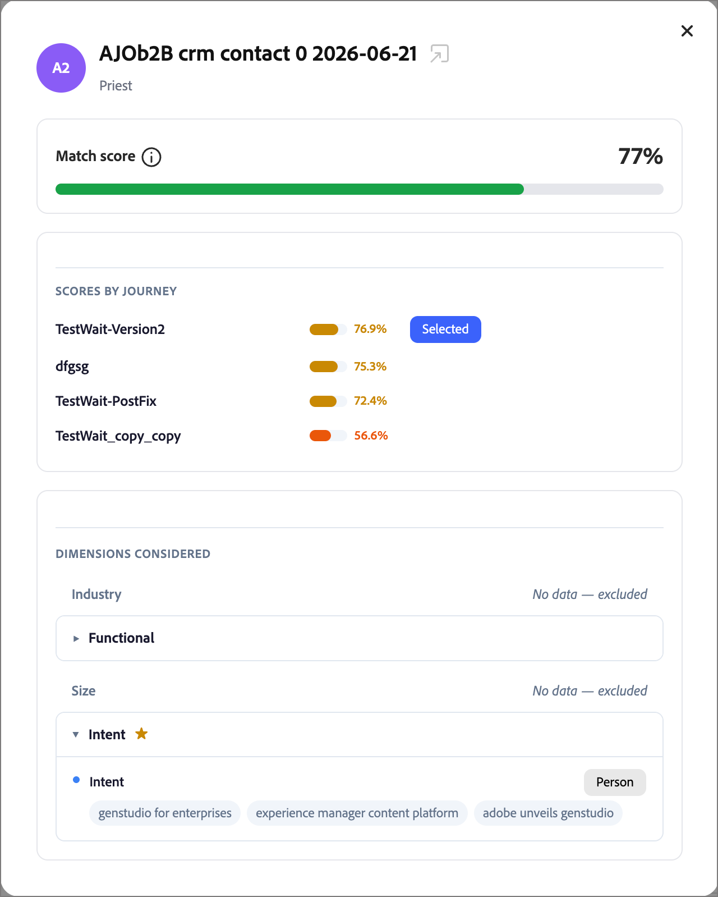
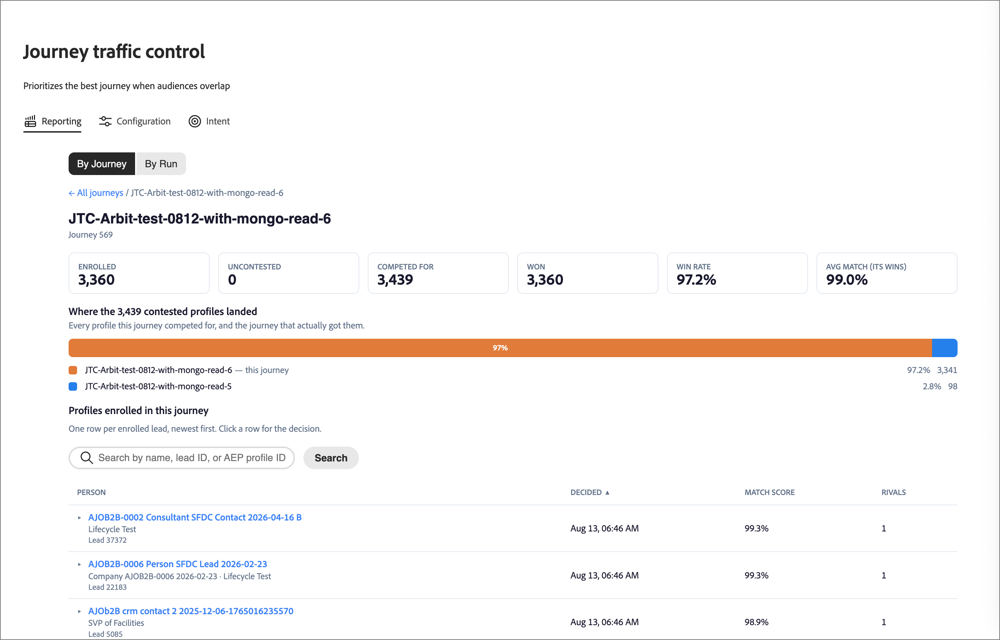

# ジャーニー交通制御

[!DNL Adobe Journey Optimizer B2B Edition]では、オーディエンスが頻繁に重複します。 金融機関のマーケティングディレクターは、自社の業界ジャーニー、製品に対する関心ジャーニー、エンタープライズアカウントジャーニーに対して、同日に適格性を判断する可能性があります。 連携していない場合、その人物は3つすべてに登録され、競合または冗長なメッセージを受け取ります。 _ジャーニーのトラフィック制御_&#x200B;を使用すると、同時に複数のジャーニーに適格である場合に、各個人に最適な1人のジャーニーを登録できます。

ジャーニー交通制御は、複数の参加ジャーニーに適格なすべての人物をレビューします。 顧客について把握している情報を各ジャーニーの目的と比較し、最適なマッチングで登録します。 1つのジャーニーのみを対象とする条件を満たすユーザーは、そのジャーニーに登録されます。 「なし」の資格を持つ人は登録されません。

## ジャーニーのトラフィック制御の利点 {#benefits}

ジャーニーのトラフィック管理では、手作業による重複管理ではなく、各担当者の判断を適切に記録する必要があります。

| 顧客がジャーニーを離れる場合 | 強化することができます |
|---|---|
| 複数のオーディエンスに一致する人物は、複数のジャーニーに登録され、重複するメッセージを受け取ります。 | 各人は、各評価に対して最大1つの参加ジャーニーに登録されます。 |
| 除外セグメントとオーディエンスルールを利用して、重複を手作業で管理しています。 管理は、新しいジャーニーが発生するたびに困難になります。 | システムは適合性に基づいて選択します。 除外ロジックを構築したり維持したりすることはありません。 |
| 人が特定のジャーニーを受け取った理由を説明するのは難しいです。 | 各競合ジャーニーのスコアを含め、あらゆる決定を記録および表示可能です。 |
| メッセージ疲労と複合メッセージはエンゲージメントを減らします。 | 一貫性のある適切なエクスペリエンスを各人に提供できます。 |

## 使用例 {#examples}

重複するオーディエンスをターゲットとするジャーニーには、ジャーニーのトラフィック制御を使用します。 例：

* **業界ナーチャリングプログラム**：金融サービス、ヘルスケア、製造業のジャーニーを別々に運営しています。 取引先責任者には業界価値はありませんが、取引先責任者のプロファイルは銀行口座にリンクされています。 ジャーニーのトラフィック制御は、3つのチャネルすべてに登録するのではなく、連絡先と金融サービスジャーニーを一致させます。
* **製品への関心キャンペーン**：製品ラインごとに1つのジャーニーを実行します。 2つの製品に関する最近の興味を示した見込み顧客は、最も関心の高い製品のジャーニーに登録されます。
* **役割ベースのメッセージ**：技術評価者には1つのジャーニーを、エグゼクティブスポンサーには別のジャーニーを実行します。 役職と部門が、どのジャーニーに参加するかを決めます。
* **エンタープライズおよびSMB プログラム**：会社の規模ごとに異なるジャーニーを実行しています。 コンタクト先の顧客セグメントとアカウント情報が、どのジャーニーに参加するかを決めます。
* **新しいジャーニーの開始**：新しいジャーニーを、他のジャーニーが既にカバーしているオーディエンスに公開します。 ジャーニートラフィック制御は重複を評価するため、既存のオーディエンスルールを再設計する必要はありません。

## 適合度による選択 {#dimensions}

個人が複数のジャーニーに適格である場合、ジャーニーのトラフィック制御では、個人のプロファイルと各候補ジャーニーの名前と説明を比較します。 比較は4つの次元をカバーしています。

| 寸法 | 比較するもの |
|---|---|
| 業界 | 個人の業界。 業界が見つからない場合は、リンクされたアカウントの業界。 |
| 機能的フィット | 個人の役割と職務。 |
| 企業規模 | 顧客セグメント、アカウントタイプ、支出のコンテキスト。 |
| 目的 | その人が最も強い最近の興味を示した製品。 |

次の点に留意してください。

* **ジャーニー名と説明が重要です。** それぞれのジャーニーが何のためのものかをシステムに伝えます。 具体的で正確な説明は、マッチ率を向上させます。
* **見つからないデータはスキップされ、推測されません。** オーディエンスがディメンションの価値を持たない場合、ジャーニーのトラフィック制御はそのディメンションをその人に対して除外します。 データを持つディメンションが決定されます。

レポートビューの各人物の決定レコードには、競合するジャーニーごとのスコアと、使用されたディメンションが表示されます。 データのないディメンションは除外としてマークされます。

### 比較 {#comparisons}

ジャーニーのトラフィック制御では、各ディメンションについて、役職などの関連テキストと各ジャーニーの説明を比較します。 次の2つの方法を使用します。

* **類似性を意味する**: テキストは説明に近い意味を持ちますか？
* **キーワード一致**：テキストは説明と同じ用語を使用していますか？

2つの方法の結果が強いほど、そのディメンションのジャーニーのスコアになります。

各ディメンションは、ベストスコアリングジャーニーを提案しますが、それはスコアが最低品質しきい値をクリアした場合に限られます。 適格な提案がないジャーニーは削除されます。 設定した重みづけは、重み付けされたスコアを組み合わせて残りのジャーニーをランク付けします。 スコアが最も高いジャーニーが選択されます。 勝者は必ずしも最も提案されたジャーニーではありません。 単一ディメンション上の1つの強力な一致は、複数の弱い一致よりも重要です。

各決定レコードには、次の情報が格納されます。

* 選択したジャーニーと競合するジャーニー
* 各ディメンションのスコアと
* 信頼値
* 上位、Mediumまたは下位の契約書レベル。勝者がサポートするディメンション数を示します

<!-- CONFIRM with Engineering: whether to describe the fallback when no dimension produces a qualifying match. The source says the person is still enrolled in one eligible journey, selected consistently, with a 0% (Low) confidence decision record. Also confirm how "consistent" should be phrased. -->

## 設定 {#configuration}

ジャーニートラフィック制御ディメンションの重みを設定し、スコアリングをシミュレートするには：

1. 左側のナビゲーションで、**[!UICONTROL ジャーニー管理]** > **[!UICONTROL ジャーニートラフィックコントロール]**&#x200B;に移動します。

1. 「**[!UICONTROL 設定]**」タブを選択します。

{width="800" zoomable="yes"}

### ディメンションの重みを調整 {#weights}

デフォルトでは、4つのディメンションはすべて&#x200B;_Medium_&#x200B;の重みを持ち、それぞれ25%で均等に割り当てられます。 重みづけを調整して、各ディメンションが意思決定に与える影響を変更します。

1. ディメンションごとに、重み付けレベルを設定します。

   * **[!UICONTROL オフ]**
   * **[!UICONTROL 低]**
   * **[!UICONTROL Medium]**
   * **[!UICONTROL 高]**

   各カードのパーセンテージは、設定を組み合わせた後のディメンションのシェアを示します。 ディメンションを決定から削除するには、ディメンションを&#x200B;**[!UICONTROL オフ]**&#x200B;に設定します。

   {width="600"}

   各カードに表示される割合は、すべての選択を組み合わせた後、そのディメンションの正規化された貢献度で、常に100%になります。 1つのディメンションを上げると、システムは自動的に他のディメンションを再正規化し、合計は100%に留まります。

   「**[!UICONTROL 次にリセット]**」をクリックすると、すべてのディメンションを均等な重みに戻すことができます。

1. 調整された重みを適用する場合は、**[!UICONTROL 重みを保存]**&#x200B;を選択します。

   >[!NOTE]
   >
   >ディメンションの重みに対する変更を保存するには、_[!UICONTROL B2B管理設定の管理]_ [製品権限](../admin/user-management.md#b2b-product-permissions)が必要です。

### スコアリングのシミュレート {#simulate-scoring}

本番環境に重みをコミットする前に、トラフィック制御がこれらの変更にどのように反応するかをシミュレートできます。 シミュレーションでは、ジャーニーのトラフィック制御を有効にする必要はありません。 すでにライブジャーニーにあるプロファイルを評価し、トラフィック制御ロジックを適用します。 そして、結果がウェイト設定に適しているかどうかを判断できます。

「**[!UICONTROL スコアリングをシミュレート]**」をクリックします。

結果ヘッダーは、実行の概要を示します。

* **プロファイルが評価されました** — スコアリングされたプロファイルの数、およびジャーニーの数に基づいて評価されました。
* **Average conflicts/profile** — プロファイルあたりの競合ジャーニーの平均数。
* **平均一致スコア** – 選択したジャーニーの平均信頼度。

{width="700" zoomable="yes"}

評価された各プロファイルは、選択したジャーニー、主要な根拠、インテントシグナル、マッチスコアを示すカードとして表示されます。 プロファイルを選択して、次の方法で詳細ビューを開きます。

* **一致スコア** – 全体の一致。ディメンション別に色分けされた分類が表示されます。
* **ジャーニー別スコア** – このユーザーが対象としたジャーニー、どのジャーニーが選択されたか、およびその理由。
* **Dimensions considered** – 決定を促したディメンションデータ。基礎となるシグナルを表示するために拡張可能です。

{width="450" zoomable="yes"}

必要に応じて、ディメンションの重みを調整し、**[!UICONTROL 再実行]**&#x200B;をクリックしてシミュレーションを再実行します。

**[!UICONTROL 新しい人物のサンプル]**&#x200B;をクリックして、新しいランダムサンプルを使用してシミュレーションを再実行することもできます。

結果に満足したら、**[!UICONTROL 重みを保存]**&#x200B;をクリックして、重みを確定できます。 新しいトラフィック制御の決定は、新しい設定をすぐに使用しますが、過去の決定は影響を受けません。 テストした重みはメインの&#x200B;_[!UICONTROL 設定]_ タブに表示され、ライブ環境でトラフィック制御が評価されているジャーニーに使用されます。

重みを適用せずにページを離れることもできます。

## レポートを見る {#reporting}

レポートビューを使用して、ジャーニートラフィックコントロールがユーザーをどのように登録したかを確認できます。 決定をジャーニー別または実行別に確認します。

### ジャーニー別レポート {#reporting-by-journey}

**[!UICONTROL ジャーニー別]** ビューは、トラフィック制御下のジャーニーを要約します。

| 指標 | 説明 |
|---|---|
| 管理されたジャーニー | トラフィック制御に関与するジャーニー。 |
| コンテスト済みのジャーニー | もう1つ以上のジャーニーで個人を共有するジャーニー。 |
| コンテストのプロファイル | 2つ以上のジャーニーによって要求される個別の人物。 |
| 登録済みユーザー | 個別のユーザーが登録されました。 |

ジャーニーごとに、ビューには次の値も表示されます。

* **[!UICONTROL Enrolled]**：登録された合計人数。
* **[!UICONTROL 非競合]**：このジャーニーのみに適格なユーザー。
* **[!UICONTROL 獲得]**：複数のジャーニーに適格で、このジャーニーに登録された人物。
* **[!UICONTROL 成約率]**：人が競争したときにジャーニーが勝利した頻度。

{width="700" zoomable="yes"}

[&#x200B; ジャーニーのステータス &#x200B;](./journeys-overview.md#journey-status)でリストをフィルタリングします：[!UICONTROL &#x200B; ライブ &#x200B;]、[!UICONTROL 完了]、[!UICONTROL 中断]、または[!UICONTROL すべて]。

ジャーニーの競合したユーザーがどこで終了したかを確認するには、ジャーニーを開きます。 詳細ビューには、代わりにユーザーが登録されたジャーニーが表示されます。 一致スコア、競合するジャーニー、各ジャーニーのスコア、および使用されるディメンションを表示するには、登録済みユーザーの決定レコードを展開します。 名前、リード ID、プロファイル IDで検索します。

{width="700" zoomable="yes"}

業界またはインテント製品がジャーニー全体でどのように分布しているかを比較するには、**[!UICONTROL ジャーニーを比較]**&#x200B;し、少なくとも2つ、最大20個のライブジャーニーを選択します。

<!-- Figure placeholders: By Journey overview, journey detail "Where contested profiles landed", and a decision record. Redact person names and use clean sample journey names without test prefixes. Choose runs with healthy enrollment counts. -->

### 実行別レポート {#reporting-by-run}

「**[!UICONTROL 実行ごと]**」を選択すると、各評価実行のリストと次の情報が表示されます。

* 実行の時間
* 実行のトリガー方法：*スケジュール済み*、*オンパブリッシュ*、または&#x200B;*手動*
* 評価された人、登録された人、登録されていない人の数

{width="700" zoomable="yes"}

期間（24時間、7日間、30日間など）とトリガーの種類でリストをフィルタリングします。

評価された人物から登録されたジャーニーまでのフロー図を表示するには、実行を開きます。 各ジャーニーの内訳は、**[!UICONTROL 登録済みでない]**、**[!UICONTROL 登録済み]**、**[!UICONTROL 仲裁済み]** （競合するジャーニーの中から選択）、**[!UICONTROL 非競合]**&#x200B;の人数を示します。 実行中のジャーニーでは、評価された人物、結果、競合したジャーニー、マッチスコアも表示できます。

ジャーニー全体で評価済みの人物とその登録結果を示す{width="500" zoomable="yes"}

<!-- CONFIRM with Product: what the scheduled and on-publish triggers mean for customers, and the content of the Not enrolled tooltip. -->

## 評価実行プロセス {#run-process}

各実行は同じ順序に従います。 ジャーニートラフィック制御は、[!DNL Journey Optimizer B2B Edition]環境に既に存在するデータのみを読み取り、追加のデータソースを必要としません。

1. ジャーニーのトラフィック制御は、ユーザーとアカウント [のプロファイル更新](../data/data-availability-timing.md#daily-refresh)が正常に完了するのを待ちます。 更新が失敗した場合、古いデータに対する実行は開始されません。

1. オーディエンスメンバーシップは、[!DNL Adobe Experience Platform]および[同期](../data/data-availability-timing.md#platform-sync)から[!DNL Journey Optimizer B2B Edition]で計算されます。 セグメント化が完了すると、システムは同期が完了するのを最大30分間待ちます。 同期が早く終了すると、処理はすぐに開始されます。 最初に30分が経過した場合は、処理が開始されます。 同期が後で終了すると、更新されたデータに対して新しい実行が開始されます。

1. このシステムは、候補者ジャーニーを編成します。 ライブでトラフィック制御が有効になっているジャーニーのみが参加します。 システムは、各ジャーニーのステータス、名前、説明を読み取ります。

1. オーディエンスメンバーシップとプロファイルコンテキストが小さなバッチで読み取られます。

1. システムは実施要件をチェックします。 次のすべてに該当する場合にのみ、個人がジャーニーの対象となります。

   * ジャーニーがライブになり、トラフィック制御が有効になります。
   * 人物は現在、ジャーニーのオーディエンスのメンバーです。
   * この人物は、以前にそのジャーニーに正常に登録されていません。
   * そのユーザーは、現在そのジャーニーに登録されていません。

1. システムがジャーニーを選択します。 1つの対象ジャーニーを持つユーザーが登録されます。 対象となるジャーニーがないユーザーは登録されません。 複数の対象となるジャーニーを持つユーザーの場合、システムはそのユーザーのプロファイルと、各ジャーニーの名前と説明を[4つのディメンション &#x200B;](#dimensions)で比較します。

1. 標準ジャーニー登録メカニズムを使用して、選択したジャーニーに登録が送信されます。

1. レポートと監査のために、各決定と登録結果が保存されます。

1. システムチェックポイントは、バッチ処理が完了するにつれて進捗を確認し、結果を記録し、完了通知を送信します。

## 使用および保存されるデータ {#data}

ジャーニーのトラフィック制御では、次のデータを使用します。

| データ | ソース | 用途 |
|---|---|---|
| ジャーニーのステータス、名前、説明 | ジャーニー | どのジャーニーが参加し、各ジャーニーが何を目的としているかを決定します。 |
| オーディエンスのメンバーシップ | [!DNL Experience Platform]人のオーディエンスが[!DNL Journey Optimizer B2B Edition]に同期されました | 各ジャーニーの選定者を特定する： |
| 業界、役職、部門、顧客セグメントなどの人物プロファイル | 個人データ | 業界、機能的な適合性、企業規模の側面を提供する。 |
| 業種やアカウントタイプなどの、リンクされたアカウントプロファイル | あなたのアカウントデータ | 個人の価値が欠落している場合は、業界を埋め、アカウントのコンテキストを提供します。 |
| 製品への関心 | あなたの[&#x200B; インテントデータ &#x200B;](../admin/intent-data.md) | インテントディメンションを指定します。 最も強い、最も最近の関心を持つ製品が使用されます。 |
| 登録履歴 | 過去の実行によって書き込まれたレコード | 同じジャーニーに同じ人物を繰り返し登録することは避けてください。 |
| 現在の登録ステータス | [!DNL Journey Optimizer B2B Edition] | 既にジャーニーにエントリしている人物を登録するのは避けます。 |

実行ごとに、ジャーニートラフィック制御は実行サマリーを保存します。 登録済みの個人ごとに、登録決定レコードが保存されます。 両方とも、お客様の環境のAdobeが管理するデータストアに保存されます。 レポートを強化し、再登録を防ぎます。

<!-- 
CONFIRM with Engineering, Security, and Legal before publishing. The source material does not state any of the following data handling commitments:
- Where processing occurs and data residency.
- Whether meaning similarity comparison uses a third-party or externally hosted AI service, and whether profile text leaves the Adobe environment.
- Whether customer data is used to train models shared with other customers.
- The retention period for decision and enrollment records, and how they are deleted when a person is erased (link to privacy requests).
- Encryption in transit and at rest, role-based access to the reports, and tenant isolation. 
-->

## ジャーニーのトラフィック制御の設定 {#setup}

_ドラフト_ ステータスの個別[個人ジャーニー](./create-publish-journey.md)で、ジャーニートラフィック制御を直接有効にできます。

1. ジャーニーの明確な目的と目標を提供するために、ジャーニーに名前と説明を付ける必要があります。

   これらの名前と説明は、一致の基礎となります。

1. **[!UICONTROL をクリック…ジャーニーキャンバスの右上にある詳細]**&#x200B;を選択し、**[!UICONTROL ジャーニートラフィック制御の設定]**&#x200B;を選択します。

   {width="400"}

1. ダイアログで、**[!UICONTROL ジャーニートラフィック制御を有効にする]** オプションを有効にします。

   設定ダイアログでは、動作について説明します。有効にすると、ジャーニーが候補になり、モデルは、複数のアクティブなジャーニーに適格なユーザーに最適なジャーニーを評価して推奨します。

   {width="450"}

   >[!IMPORTANT]
   >
   >ジャーニーのステータスが&#x200B;_ドラフト_&#x200B;のままである間は、いつでも切り替えを変更できます。 ジャーニーのトラフィック制御を有効にしてジャーニーを公開すると、そのジャーニーへのエントリが評価され、設定を無効にできなくなります。

1. 「**[!UICONTROL 保存]**」をクリックします。

1. [人物ジャーニーを公開](./create-publish-journey.md#publish-a-journey)します。

## 制限と依存関係 {#limitations}

次の依存関係は、ジャーニーのトラフィック制御が機能するタイミングと機能のレベルに影響します。

* **オーディエンスの同期**：決定は、[!DNL Experience Platform]から[!DNL Journey Optimizer B2B Edition]に同期された最新のオーディエンスメンバーシップに依存しています。 実行タイミングは、セグメント化と同期の完了に従います。 決まったスケジュールではありません。
* **プロファイルの更新**：実行は、個人とアカウントのプロファイルの更新が成功した後にのみ開始されます。
* **ジャーニーメタデータ**: トラフィック制御が有効になっているライブジャーニーのみが参加します。 マッチングの品質は、書き込む名前と説明によって異なります。
* **プロファイルの完全性**：品質は、保持する個人、アカウント、インテント データによって異なります。 見つからない寸法はスキップされます。

ジャーニートラフィック制御には、次の制限があります。

* **1人につき1つのジャーニー**:1人のユーザーは、1回の実行ごとに最大1つのジャーニーに登録されます。
* **Selectionでは、登録は保証されません**: [!DNL Experience Platform]からの同期が完了するまで、一部のプロファイルは、一致するMarketoのユーザーIDなしで評価される場合があります。 ジャーニーが選択されていますが、登録が成功しない可能性があります。 これらのユーザーは、実行レポートに&#x200B;*登録されていません*&#x200B;と表示されます。
* **繰り返し登録なし**：以前に登録したジャーニーにジャーニーのトラフィック制御が登録されない。 ユーザーがジャーニーを再評価できるようにするには、[&#x200B; ジャーニーの再エントリ設定](./journey-re-entry.md)を使用します。
* **リアルタイムではない**：実行が発生した場合は、プロファイルが変更された場合ではなく、決定が行われます。
* **4つの固定ディメンション**：業界、機能的な適合性、企業の規模、意図の重要性を調整できますが、ディメンションを追加することはできません。
* **一致するテキストベース**:ジャーニー名と説明がプロファイルテキストと比較されます。 あいまいな説明、空白、または類似の説明を持つジャーニーは、区別が難しくなります。 ジャーニーが分断されていると、信頼性の低い結果につながる可能性があります。

ジャーニーのトラフィック制御は、どの対象ジャーニーに登録されているかを決定するだけです。 ジャーニーやオーディエンスは変更されません。

<!-- CONFIRM with Product and Engineering: the maximum number of governed journeys, maximum audience size for each run, supported editions and regions, and any language limitations for text matching. -->
